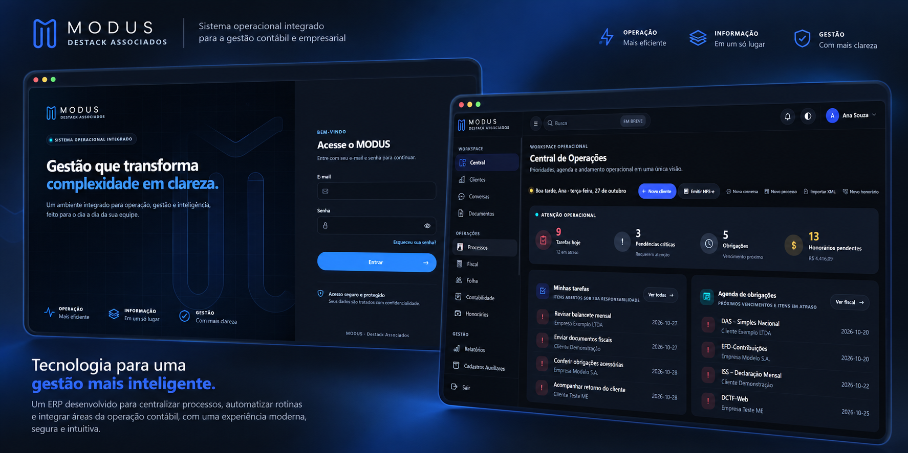
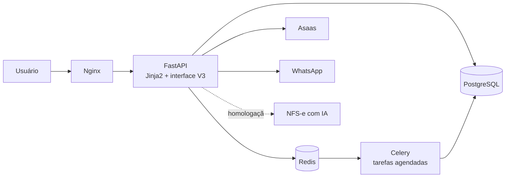

  
   
  Imagem ilustrativa das telas de login e da Central de Operações do MODUS.

<h1 align="center">MODUS</h1>

<strong>ERP para escritórios de contabilidade: cobranças, fiscal, processos e atendimento em uma única plataforma.</strong>

Python · FastAPI · PostgreSQL · Celery · Tailwind CSS · Asaas · WhatsApp

---

## Sobre o projeto

O MODUS é o ERP da **Destack Associados**, escritório de contabilidade. Ele nasceu da rotina da operação, em que cobranças, obrigações fiscais, emissão de notas e atendimento viviam em planilhas, e-mail, WhatsApp e sistemas separados. A plataforma reúne esses fluxos, com controle de acesso por perfil e por carteira de clientes, automações agendadas e integrações externas.

Desenvolvi o sistema de ponta a ponta: levantamento de requisitos, modelagem de domínio, backend, interface, integrações, automações, testes e publicação.

> **Sobre este repositório.** O código-fonte do MODUS é **privado**, pois o sistema trabalha com dados de clientes. Este repositório existe apenas para apresentar a arquitetura, as decisões técnicas e o estado atual do projeto. Não há código, dados ou configurações da aplicação aqui.

## Estado do projeto

| Frente | Estado |
|---|---|
| Plataforma (FastAPI, PostgreSQL, Celery) | **Em produção** |
| Automação de cobranças com Asaas | **Em produção** |
| Autenticação nativa em PostgreSQL | **Em produção** |
| Interface MODUS V3 (Tailwind CSS + design system próprio) | **Em produção** |
| Emissor de NFS-e com IA | **Em homologação** |

## Destaques

### Automação de cobranças com Asaas
Integração com o Asaas para gerar cobranças a partir dos contratos de honorários e **atualizar automaticamente o status de cada cobrança após a confirmação do pagamento**. Os eventos recebidos por webhook são idempotentes (cada evento é processado uma única vez), e operações que criam cobranças não são repetidas automaticamente, para evitar cobrança em duplicidade. O módulo de honorários também cobre contratos, eventos recorrentes, reajustes, inadimplência e comissões.

### Modernização da autenticação
A identidade dos usuários saiu de um serviço legado em Node.js/MongoDB para um provedor nativo em PostgreSQL, hoje em produção: senhas com bcrypt, sessão por JWT em cookie, ativação de conta por e-mail e redefinição de senha com tokens de uso único, além de controle de acesso por perfil, permissão e carteira de clientes. A migração foi feita em etapas, com testes que provam o funcionamento sem o serviço legado e a possibilidade de voltar atrás. O serviço legado foi desativado.

### Interface MODUS V3
Nova interface construída com **Tailwind CSS** e um **design system próprio** (tokens de design, App Shell e biblioteca de componentes), publicada módulo a módulo por meio de feature flags, com possibilidade de rollback por configuração.

### Emissor de NFS-e com IA (em homologação)
Fluxo em testes para emitir notas de serviço a partir de mensagens em linguagem natural (WhatsApp ou e-mail):

1. Um modelo de linguagem **extrai apenas fatos comerciais** da mensagem (tomador, valor, descrição).
2. **Regras determinísticas**, e não o modelo, decidem classificação fiscal, provider, retenções e ambiente.
3. A emissão passa por confirmação, validação e adaptadores por município.

O fluxo roda em modo piloto, com chave de desligamento própria. **Ainda não é um recurso em produção.**

## Módulos

Os módulos abaixo estão implementados. Os estados de produção confirmados estão na tabela "Estado do projeto".

| Área | Descrição |
|---|---|
| Honorários e cobranças | Contratos, eventos recorrentes, cobranças via Asaas, inadimplência, comissões e carteiras |
| Clientes | Cadastro fiscal, contatos, serviços contratados e visão 360° |
| Fiscal | Apurações, guias, obrigações, agenda fiscal e enquadramento tributário com vigência |
| NFS-e e NFe | Adaptadores para São Paulo, Betha e Emissor Nacional; NFe, DANFE e carta de correção |
| Contábil | Plano de contas, balancete e DRE |
| Folha e departamento pessoal | Funcionários, movimentações e folha |
| Processos | Tarefas, aprovações, histórico, agenda e central de notificações |
| Documentos | Modelos DOCX e central de documentos |
| Canais | WhatsApp e e-mail |

## Arquitetura

Monólito modular em três camadas: rotas finas (validação e autorização), regras de negócio e acesso a dados, e um cliente isolado por serviço externo. As mesmas regras atendem requisições HTTP e tarefas em segundo plano.

## Tecnologias

| Camada | Tecnologias |
|---|---|
| Backend | Python, FastAPI, SQLAlchemy 2 (async), Pydantic, Celery, Redis |
| Banco de dados | PostgreSQL |
| Frontend | Jinja2, JavaScript, Tailwind CSS, design system próprio |
| Integrações | Asaas, WhatsApp, e-mail, provedores de NFS-e, modelos de linguagem (em homologação) |
| Documentos | Geração de PDF e DOCX, assinatura de XML fiscal |
| Qualidade e entrega | pytest, GitHub Actions (deploy automatizado), feature flags |

## Autora

**Izabela Pordeus**, desenvolvedora full-stack.  
[LinkedIn](https://www.linkedin.com/in/izabela-pordeus-de-almeida)

## Licença e uso

Este repositório é uma apresentação do projeto. O código-fonte do MODUS é privado e não está disponível para uso, cópia ou redistribuição.
